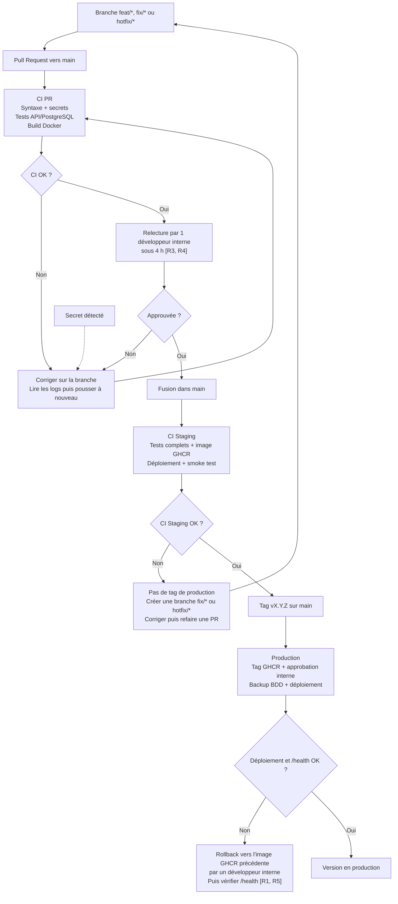

# Conception du Pipeline CI/CD (`docs/pipeline.md`)

Ce document décrit le fonctionnement de notre chaîne de livraison automatisée (GitHub Actions), de la création d'une Pull Request jusqu'à la mise en production. Chaque étape répond aux risques identifiés dans `docs/risques.md` (`[R1]` à `[R5]`) et à notre carte contexte.

> **Statut d'implémentation au 19/11/2026** : CI de PR et CD implémentés. `ci.yml` couvre les secrets, le lint, les tests PostgreSQL et le build. `cd.yml` publie l'image GHCR, exécute le staging et le smoke test, puis déploie la production sur tag avec approbation. `rollback.yml` permet le retour à une version antérieure sans rebuild. La production nécessite les secrets `PROD_*` et l'environnement `production` configurés par un admin ; voir `docs/deploy.md`. Les migrations Alembic arrivent dans une PR séparée.

---

## 1. Schéma du pipeline (de la PR jusqu'à la Production)

## 2. Tableau détaillé des étapes du pipeline

| Étape | Déclencheur | Durée estimée | Bloquante ? | Justification (Risque traité) |
| :--- | :--- | :--- | :--- | :--- |
| **1. Vérification syntaxe & scan de secrets** | Ouverture ou push sur une PR | ~30 sec | **Oui** | `[R2]` Empêche qu'un fichier `.env` ou un mot de passe soit envoyé par erreur sur le dépôt public. |
| **2. Tests automatiques (API + base de test)** | Ouverture ou push sur une PR | ~1 min 30 | **Oui** | `[R1, R4]` Vérifie que l'application et la base fonctionnent ensemble et empêche le code non testé d'entrer dans `main`. |
| **3. Test de build Docker** | Ouverture ou push sur une PR | ~1 min | **Oui** | `[R1]` Garantit que l'application s'empaquette correctement avant même la relecture humaine. |
| **4. Relecture & approbation PR (Humain)** | Fin des étapes 1 à 3 au vert | < 4 h (SLA) | **Oui** | `[R3, R4]` 1 seul relecteur interne suffit : garantit la qualité avant l'arrêt du projet sans ralentir l'équipe ni facturer d'attente au freelance. |
| **5. Publication image sur GHCR (`sha-...`)** | Fusion (*merge*) de la PR dans `main` | ~1 min | **Oui** | `[R1, R5]` Remplace l'ancien tag `:latest` par des images numérotées et archivées, prêtes à être réutilisées. |
| **6. Déploiement Staging & Test de fumée** | Fin de la publication sur GHCR | ~1 min | **Oui** | `[R1]` Teste le démarrage réel du conteneur et vérifie que `/health` répond OK avant d'envisager la production. |
| **7. Approbation Production (Humain)** | Création d'un tag `vX.Y.Z` sur `main` | Manuel (~2 min) | **Oui** | `[R2, Carte Contexte]` Seuls les 3 développeurs internes peuvent autoriser le passage en production (contrôle strict avant le gel du produit). |
| **8. Backup BDD & Déploiement Production** | Approbation validée sur GitHub | ~1 min 30 | **Oui** | `[R1, R5]` Sauvegarde les données avant toute modification et déploie la version exacte sur le serveur. |
| **9. Contrôle final `/health` (Smoke test)** | Fin du déploiement en Production | ~20 sec | **Oui** | `[R1]` Fait échouer le pipeline immédiatement si le service ne répond pas ou n'affiche pas le bon numéro de version. |

---

## 3. Gestion des échecs CI

Un échec bloque toujours l'étape suivante :

* **CI de la PR en échec :** la PR reste bloquée. L'auteur lit les logs, corrige sur la même branche et pousse à nouveau. Le CI est relancé automatiquement.
* **Secret détecté :** le secret est révoqué et remplacé immédiatement ; l'incident est documenté `[R2]`.
* **CI Staging en échec :** aucun tag de production n'est créé. Une branche `fix/*` ou `hotfix/*` est créée, puis une nouvelle PR est ouverte vers `main`.
* **Production ou `/health` en échec :** le déploiement est considéré comme un incident. Un développeur interne effectue le rollback vers l'image GHCR précédente et vérifie `/health` `[R1, R5]`.

---

## 4. Procédure de retour arrière (Rollback — Objectif < 5 minutes)

En cas de panne en production (même après la livraison finale lors d'un cas de **force majeure** `[Carte Contexte]`) :

* **Qui la déclenche ?** L'un des **3 développeurs internes** uniquement (le freelance n'a pas accès à la production `[R2]`).
* **Comment ?** Depuis l'onglet **Actions** de GitHub (*Run workflow*), en saisissant l'ancien numéro de version stable (ex : `v1.0.0`). Le pipeline récupère directement l'ancienne image Docker déjà prête sur GHCR (sans recompiler), redémarre le serveur et vérifie `/health` `[R1, R5]`.
* **En combien de temps ?** **1 à 2 minutes** (objectif < 5 min respecté car l'image est déjà construite).
* **Ce qu'elle ne sait pas annuler `[R1]` :**
  1. **Les suppressions en base de données :** si une table ou une colonne a été supprimée, revenir à l'ancien code ne la recrée pas (il faut restaurer la sauvegarde automatique faite avant le déploiement).
  2. **Les fausses données enregistrées pendant la panne :** les commandes invalides créées pendant l'incident restent en base et doivent être nettoyées à la main.
  3. **Les actions externes :** les e-mails ou notifications déjà envoyés aux clients pendant la panne.

---

## 5. Fichiers d'implémentation

- `.github/workflows/ci.yml` : CI de PR (secrets, lint, tests, build).
- `.github/workflows/cd.yml` : publication GHCR, staging et release sur tag.
- `.github/workflows/rollback.yml` : rollback manuel par version.
- `deploy/docker-compose.prod.yml` : stack de production.
- `scripts/deploy.sh` : backup, pull, redémarrage et smoke test.
- `docs/deploy.md` : secrets, environnements et runbook de release/rollback.
